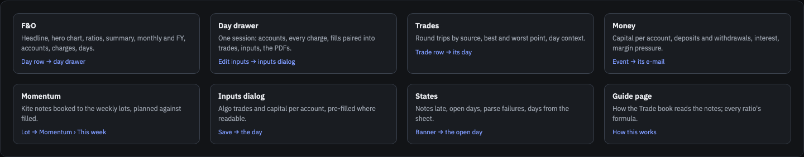
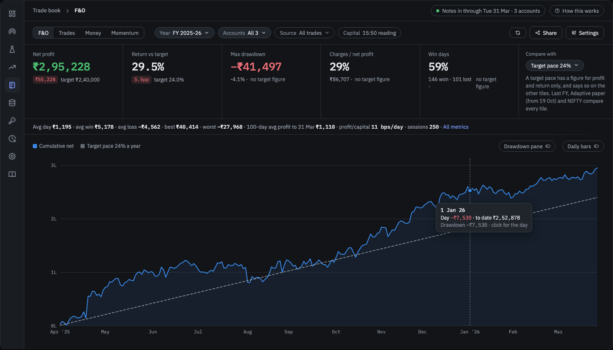
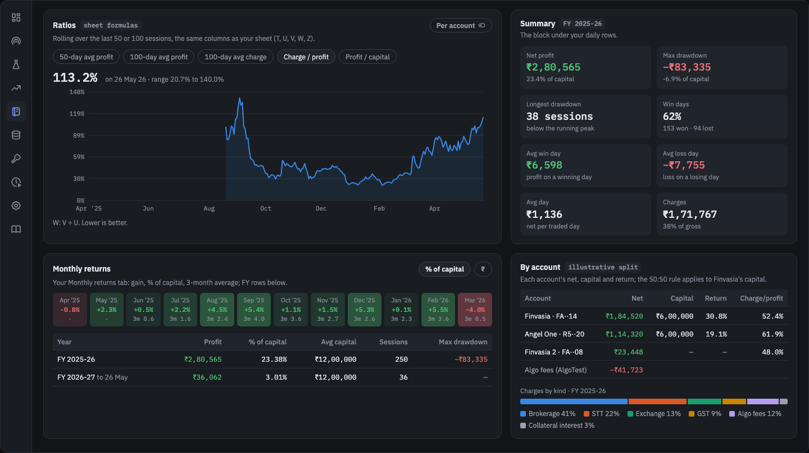
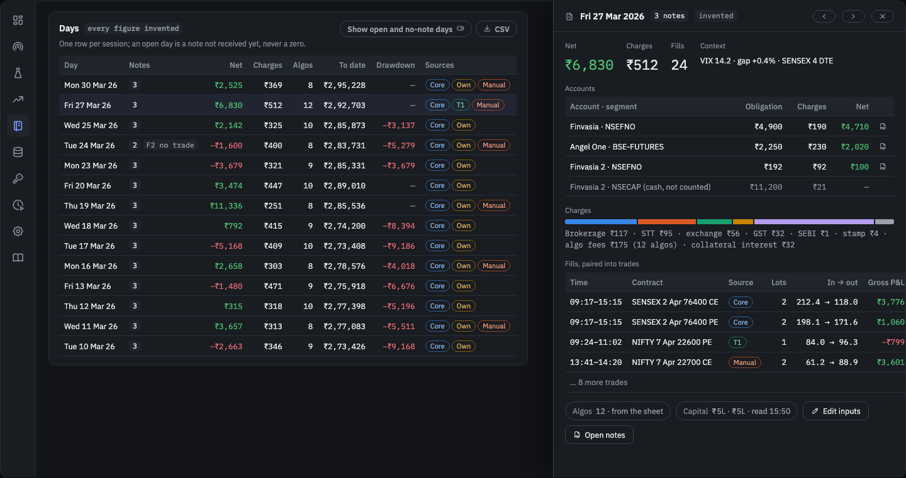
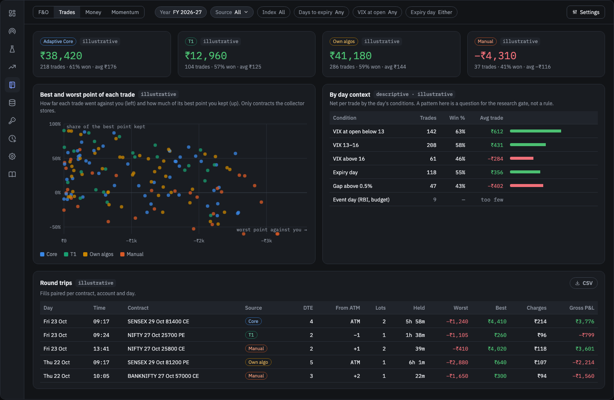
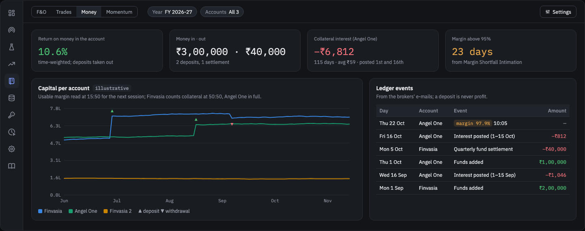
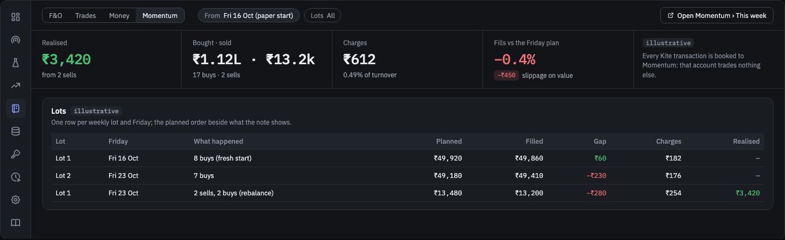
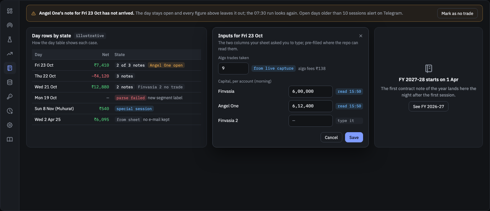

# BL-168 — Contract notes in the repo: laptop job, data store, Trade book page

| | |
|---|---|
| **Priority** | P1 — the only record of real money the project measures itself against; unblocks BL-093 and BL-026 |
| **Status** | In progress (Phases 1, 2 and 4 done; Phase 3 built, its sheet differences wait for the owner; Phase 6 built, done after a real backup run; Phase 5 page built (PR #345), in review) |
| **Type** | feature |
| **Area** | contract-notes / scheduler / trading-data / dashboard |
| **Created** | 2026-10-26 |
| **Depends on** | BL-012 (the scheduler, installed); `BROKER_ACCOUNTS_JSON` in the repo-root `.env` (done 2026-10-26) |
| **TODO.md row** | 2.10 |

## Context

The owner's realised F&O P&L lives in the Google Sheet "Trade Book 2025-26 FY" (one row per
trading day from 1 Apr 2025: the Finvasia and Angel One blocks, plus two hand-entered columns —
`Algos` and `Capital` — and formula columns: `algo charges` (`ROUNDUP((Algos-3)*12.5+62.5)` in
the owner's private copy), `Charges`, `Profit`, `Overall`, `DD`, 50/100-day averages, charge/profit
ratio, bps on capital; a second tab with monthly and FY returns). The sheet is filled nightly by the `trade-analytics` repo's GitHub Actions cron
(Gmail → PDF → parse → sheet). `packages/contract-notes` is the same pipeline merged here on
2026-09-19, never cut over: TODO §2.1–2.6 planned to move the *Actions* cron, re-seed the
`row-tracker` artifact and keep the sheet as the only store.

That plan predates the scheduler (BL-012). Today every other daily job runs on the laptop from
`apps/scheduler`, the research data lives under `TRADING_DATA_ROOT`, and two items wait on the
contract notes being in the repo: BL-093 (paper vs real for the rotation) and BL-026 (realised
vs backtest). Both need more than the five figures the sheet holds — they need the trades.

The sheet's five columns per account come from the note's *obligation table* (F&O rows only).
The parser already has the whole decrypted PDF in hand and throws the rest away: the itemised
charges (STT, exchange transaction, SEBI, stamp duty, GST, clearing, IPF), the trade rows
(contract, buy/sell, quantity, price, time), the note number and settlement, the cash-segment
rows it drops.

## Goal

- The daily pipeline runs as a scheduler job on the laptop and writes the day's figures to a
  store under `TRADING_DATA_ROOT`. **This repo never touches the Google Sheet** (owner,
  2026-10-26): `trade-analytics` keeps filling it as today, on its own, for as long as the
  owner wants the sheet; the two Actions workflows here and `row_tracker.json` are deleted.
- The store holds, per broker account and day: the sheet's five figures, every charge itemised,
  every trade row, the note's identifiers, and the PDF itself. History from 1 Apr 2025 is in it
  (the sheet's rows at least; the trades wherever the e-mail still exists).
- The dashboard has a **Trade book** page with what the sheet shows today (cumulative net,
  drawdown, monthly and FY returns, charges, per-account split, the day table, and every ratio
  the sheet tracks, by the sheet's own formulas) and what it cannot (charges by kind, trades
  by source, round trips with their best and worst point, day context, money in and out,
  missing-note days), designed and approved as mockups before it is built.
- The store is in the monthly backup. The sheet stays a second, independent copy until the
  owner archives `trade-analytics` (TODO §2.7), on the page's evidence, not this item's.

## Out of scope

- Any order, square-off or broker API login: the e-mail is the only source.
- The paper-vs-real reconciliation itself (BL-093) and realised-vs-backtest (BL-026): this item
  gives them their data.
- Writing the Google Sheet, or changing what its hand-entered and formula columns compute:
  `updateSheet.js`, `checkDates.js` and `sheetStartColumn` leave the package with Phase 1.
- Hiding the page from the friends: the owner chose visible to all (2026-10-26); revisit if a
  second person starts using the hosted dashboard for it.
- Tagging discretionary trades, the algo-override account and behaviour patterns: BL-169,
  which reads this item's trades by source.
- Acting on any slice of the analytics: they are descriptive. A pattern worth acting on is
  pre-registered and tested on later days under the research gate (CLAUDE.md).

## Design

**Store — `TRADING_DATA_ROOT/contract-notes/`** (the BL-141 `rotation/live/` pattern: the Node
pipeline writes files, Python reads them with DuckDB; no catalog migration until something needs
a join the files cannot give):

- `raw/<broker>/<account>/<day>.pdf` — the note as received (encrypted) and
  `<day>.decrypted.pdf`. Provenance and a re-parse source when an extractor improves.
- `days/<day>.jsonl` — one line per account-day:
  `{day, broker, account, status: 'note' | 'no_trade', note_no, settlement_no, settlement_date,
  source: 'email' | 'sheet', pdf_sha256, segments: [{label, kind: 'fno' | 'cash' | …,
  obligation, brokerage, charges: {stt, transaction, sebi, stamp, gst, clearing, ipf}, net}],
  fno: {payin_payout_obligation, net_brokerage, other_charges, total_charges, final_net},
  trades: [{order_no, trade_no, time, exchange, segment, symbol, underlying, expiry, strike,
  kind: 'CE' | 'PE' | 'FUT' | 'EQ', side, qty, price, brokerage}], account_charges: [...],
  cross_checks: {note_total_net, matched: true}}`.
  The `fno` block is what the sheet's five columns hold, so the page and the sheet can be
  compared figure for figure.
- `manual/<day>.json` — the inputs the sheet carries today by hand, written by the page
  (BL-140-style POST) or imported once from the sheet (owner, 2026-10-26):
  - `algos` — the number of algo trades taken that day (AlgoTest executions); `algo_charges`
    is AlgoTest's fee for them, the sheet's formula, computed, not typed. From 2026-10-19 the
    page pre-fills `algos` from the day's live capture (`rotation/live/<day>.jsonl`, every
    strategy that ran) and the owner corrects it.
  - `capital` — the margin available that morning, **per account**, because the brokers count
    collateral differently: Finvasia applies the 50:50 rule (usable = min(total, 2 × cash):
    ₹1 lakh cash + ₹2 lakh non-cash = ₹2 lakh usable), Angel One lets the whole ₹3 lakh be used
    and charges the collateral interest above for the cash shortfall. Read **post-market**
    (owner, 2026-10-26): a `contract-notes-capital` step at 15:50 on trading days, after the
    square-offs and the live capture, reads both accounts the way the 09:05 margin check does
    (Finvasia from AlgoTest `GET /brokers`, Angel One from `obt angel funds`, read-only, under
    the same login guards) and writes the figure to `manual/` as the **next session's**
    `capital` per account (and the day's `closing_funds`); the page shows it; a session whose
    read did not happen is typed.
- **What "done" means.** A day is closed for an account when its note is stored (`note`), or
  as `no_trade` when a later session's note for that account has arrived and this day's has
  not (the broker issues a note only for a day with trades — Kite will be `no_trade` on most
  days), or when the owner marks it so. Until then it is **open** and every run re-scans it,
  for up to 10 trading days back; an open day older than that alerts. Done is read from
  `days/`, not from a sheet read or an artifact.

**Job — `contract-notes`** in `apps/scheduler/src/jobs.ts`: **every day** 00:00 (`everyDay`,
not `tradingDays`: a session's notes arrive its evening, so the run after midnight takes it and
Saturday's run takes Friday) with `contract-notes-retry` at 07:30 for the days still open
(owner, 2026-10-26), `catchUpHours: 24`, one `group`, retries 1. Steps (argv, in
`packages/contract-notes`): for every open trading day (above) — `fetch` → `parse` → `store`.
A note not in the mailbox yet leaves the day open; a parse failure alerts with the `fixHint`
and leaves it open, as the Actions loop did. No sheet step. Needs `qpdf` from Homebrew
(installed: 12.4.1) and Node 20: the runner's `jobPath` already puts fnm's Node first
(`env.ts`), so the shell's nvm v16 default is not what jobs see (the package stays
Node/CommonJS; TODO §2.9 is unchanged). The one secret is `BROKER_ACCOUNTS_JSON` in the
repo-root `.env` (the key is there, empty, as of 2026-10-26; its `sheetStartColumn` fields are
ignored and may be left out); the `GOOGLE_*` / `SHEET_*` keys are not needed and are removed
from `.env`. The package does not import
`@trading/notify`; the scheduler's alert path does, so `alerts.ts` registers the Gmail and PDF
passwords from `BROKER_ACCOUNTS_JSON` with `registerSecret` before any failure alert can quote
a log line.

**Brokers.** Finvasia and Angel One as today, plus a `kite` plugin for Zerodha (owner,
2026-10-26): its note is read daily, and every transaction in it is booked to Momentum, since
that account trades nothing else. The e-mails, as seen in the mailboxes on 2026-10-26:

| Broker | Subject | From | Attachment |
|---|---|---|---|
| Finvasia | `Combined Contract Note for <client> dd-mm-yyyy` | Shoonya | the note PDF |
| Angel One | `Contract Note - Equity Segment` | `@angeltrade.in` | `CN_<client>_ddmmyyyy.pdf` |
| Zerodha | `Combined Equity Contract Note for <client> - <Month> <d>` | `@reportsmailer.zerodha.net` | `dd-mm-yyyy-contract-notes_<client>.pdf` |

Angel One also debits outside the contract note: **"Interest on collateral used against your
derivative trade"** (from `@angelone.in`, HTML body, no attachment, one per session, 115 so
far): *"An interest of ₹ <amount> will be charged for the collateral margin used on <day>.
The cash collateral shortfall was ₹ <shortfall>."*, by the stated formula
`(shortfall − 50000) × 0.0342%` a day, posted to the ledger on the 1st and 16th. That e-mail
is a second source (`fetch` by its subject, a small extractor), recorded as
`account_charges: [{kind: 'collateral_interest', amount, shortfall, for_day}]` on the day it
is for, so the day's net is the account's net and not only the note's. Its sibling **"Margin
Shortfall Intimation"** is a utilisation warning with no amount and is not a charge.

**Ledger e-mails.** Besides the notes and the interest e-mail, the mailboxes carry the money
moving in and out, needed so a deposit never reads as profit: "Funds added successfully",
"Instant payout request processed", "Quarterly Fund Settlement" (and the Finvasia / Zerodha
equivalents once seen), recorded per account as `funds: [{kind: 'deposit' | 'withdrawal' |
'settlement', amount, at}]`; and "Margin Shortfall Intimation" (79 so far: utilisation % and
time), recorded as `margin_events: [{at, utilisation_pct}]`.

**Analytics** (`packages/option-backtesting/src/option_backtesting/realised/`, pure functions
over the store and the lake, read-only; computed on read, nothing stored that can be
recomputed):
- **Source of every fill** — `adaptive-core`, `t1`, `own-algo` (the owner's AlgoTest /
  Quantiply strategies), `manual`: joined from the live capture (BL-141 already tells the
  tool's strategies from the discretionary ones per platform) and the uploaders' ledgers; a
  fill that matches no platform strategy is `manual`. Before 2026-10-19 (no live capture) the
  source is `unknown`.
- **Round trips** — each contract's fills paired FIFO per account and day: entry and exit time,
  holding minutes, lots, premium, P&L, charges, days to expiry, strike distance from ATM at
  entry (spot from the lake).
- **Best and worst point** — for each round trip, the contract's 1-minute bars between entry
  and exit: how far it went against the position (MAE) and in its favour (MFE). Only where the
  lake holds the contract's bars (the collected indices; not stock options); otherwise blank.
- **Day context** — VIX at open, gap, day range, IV percentile, expiry day, event day (RBI,
  budget), all from the lake and the reference data.
- **Return on money in the account** — capital from the 15:50 reading, deposits and
  withdrawals taken out (time-weighted), so the % never counts a deposit.
- **The sheet's ratios, by its own formulas** (read from the owner's private copy of the sheet, 2026-10-26):
  50-day average profit (T), 100-day average profit (U), 100-day average charge (V),
  charge / profit = V ÷ U (W), profit / capital = U × 10 000 ÷ 100-day average capital, in bps
  a day (Z); cumulative (R) and drawdown from peak (S); the summary block: net, max drawdown
  and its % of capital, longest run of sessions below the peak, win days %, average win and
  loss day, average day, profit % of capital; the monthly tab's gain, % of capital, 3-month
  average %, and the FY rows. Every one also per account.
- **F&O turnover** for the year (sum of absolute round-trip P&L) with charges as expenses, for
  the owner's CA; a figure, not tax advice.

**API and page.** `obt-api` serves `GET /legwise/contract-notes/summary|days|months|day/{day}|
ratios|trips` from the JSONL (DuckDB `read_json`, read-only, no catalog), proxied at
`/api/backtest/legwise/contract-notes/*` like the rotation routes (under `/legwise/` because
the dashboard's direct rewrite covers `/legwise/:path*` and nothing else). The page is built
from the mockups Phase 2 has the owner approve; they follow the analytics page pattern
(`apps/dashboard/CLAUDE.md`) and the dashboard's tokens. Guide page in the same change.

**Backup.** `tdata backup` copies `lake/`, `raw/` and the catalog; add `contract-notes/` (and
`rotation/`, which the same gap leaves out today). Its skip rule is "same size at the
destination", right for immutable lake files and wrong for these: `days/` lines are rewritten
when a sheet day is upgraded to e-mail, `manual/` when edited, `rotation/` nightly. The new
folders compare size **and** mtime. The sheet, filled by `trade-analytics`, is an independent
off-laptop copy of the five figures for as long as that cron runs.

## Additional data to collect (the answer to "what else")

From the note, already parsed text, currently discarded:

1. **Trade rows** — every fill with contract, side, quantity, price, time and per-trade
   brokerage. This is what lets BL-093 pick the rotation's contracts out of the account and
   compare each leg's fill with the paper fill; also AlgoTest's own charge per order check.
2. **Charges itemised** per segment — STT, exchange transaction, SEBI, stamp, GST, clearing,
   IPF — today folded into `other_charges`. Validates BL-063's charge model per kind rather than
   in total.
3. **Cash / other segment rows** — kept and labelled instead of dropped, so an equity trade on
   the same account is visible, not silently absent.
4. **Note identifiers** — contract-note number, settlement number and date, the account id as
   printed, the broker's own total net (the cross-check the parser already computes but only
   logs).
5. **The PDF** — original and decrypted, by hash, so an extractor fix can re-run history
   without Gmail.
6. **Days with no note** — recorded as such (holiday, no trade, or note missing) rather than
   left as an empty row.

Not in the note, worth attaching:

7. **The hand-entered sheet inputs** — `algos` (deploys that day) and `capital` — as a dated
   manual record; `algo_charges` is derived from `algos` by the sheet's formula. `algos` can
   later be pre-filled from the day's live capture (BL-141's `rotation/live/<day>.jsonl` lists
   every strategy that ran on each platform).
8. **Funds / margin at close** (optional, later) — `obt angel funds` already reads Angel One's
   free margin; a daily close reading gives the capital line a source other than a typed number.
9. **Debits outside the note** — Angel One's daily interest on the non-cash margin component
   (~₹80 a day, its own e-mail); any other ledger debit the brokers mail about (DP charges, AMC)
   once seen. Without these the month's net overstates the account.
10. **Zerodha Kite's notes** — every transaction booked to Momentum (the account trades nothing
   else), giving Momentum's realised buys and sells beside its paper journal.

Derived, no input from the owner (owner: "let's do all", 2026-10-26; Design → Analytics):

11. **Source of every fill** — the tool's lists, the owner's own algos, or manual.
12. **Round trips** — fills paired into trades with time, holding, premium, P&L and charges.
13. **Best and worst point of each trade** (MFE / MAE) from the lake's 1-minute bars.
14. **Day context** — VIX, gap, range, IV percentile, expiry and event days.
15. **Money in and out** and **margin pressure**, from the ledger e-mails.
16. **F&O turnover** for the tax year.

Needing a tap from the owner, in BL-169: why a manual trade was taken, the algo overrides'
account, behaviour patterns.

## Plan

### Phase 1 — Store and the laptop job (replaces TODO §2.1–2.6)
- **Tasks:** `store.js` writing `days/<day>.jsonl` and the PDFs; open-day scanning and the
  `no_trade` rule from the store; the two scheduler jobs with their `fixHint`; `qpdf` checked
  at start; `BROKER_ACCOUNTS_JSON` into `.env` (and `.env.example` with a placeholder) and the
  scheduler's secret registry; remove `updateSheet.js`, `checkDates.js` (its date helpers move
  to `store.js`), the `googleapis` / `google-*` dependencies, `contract-notes-daily.yml`,
  `contract-notes-row-tracker.yml` and `row_tracker.json` from this repo. `trade-analytics`
  is **not** touched: its cron keeps the sheet. TODO §2.1–2.6 are replaced by this phase; §2.7
  (archive the old repos) stays, for the owner, once the page has replaced the sheet; §2.8's
  typed hand-off is the `days/` line.
- **Deliverables:** the jobs, their tests (Jest for the package, Vitest for the scheduler
  entries), `technical.md` and TODO §2 rewritten, the package `CLAUDE.md` rewritten, the
  runbook's cutover section replaced by two lines (this repo stores, `trade-analytics` keeps
  the sheet; nothing to roll back).
- **Done when:** one real overnight run writes a day to the store whose `fno` block equals the
  sheet row `trade-analytics` wrote for the same day; a second run on the same day writes
  nothing; a laptop asleep at 00:00 and 07:30 catches up on wake.

### Phase 2 — UI design (its own phase, owner 2026-10-26; done before Phase 1)
- **Tasks:** mockups of every screen with the dashboard's tokens (Quant Studio, IBM Plex,
  dark), the analytics page pattern, and invented daily figures run through the sheet's formulas (read
  from the owner's private copy); illustrative cards marked as such:
  the page map; the Trade book (run bar, headline strip, hero, ratios, summary block, monthly
  and FY, accounts, charges by kind, day table); the day detail; trades (round trips by
  source, best / worst point, day context); money in and out and margin pressure; Momentum
  (Kite lots); the manual-input editor; empty and open-day states.
- **Deliverables:** `backlog/assets/BL-168/` — the HTML mockup and one PNG per screen,
  embedded in this item under **Mockups** (the BL-049 precedent).
- **Done when:** the owner approves the mockups (a Log line); changes asked for are made
  first.

### Phase 3 — Richer extraction, ledger e-mails and history
- **Tasks:** both extractors emit the itemised charges, segment rows, trade rows and note
  identifiers (the obligation cross-check stays a hard error); the Angel One interest e-mail,
  the ledger e-mails (funds, payouts, settlements, margin shortfall) and the `kite` plugin;
  Finvasia's older note layout (its notes to about 25 Aug 2025 have no "Obligation Detail"
  table the extractor finds — seen on a test run, 2026-10-26) for the history backfill;
  the history backfill and the sheet comparison (revised 2026-10-27, PR #336): the e-mails
  cover every account back to Jun 2024, so the store holds e-mail figures only — nothing is
  imported from the sheet as `source: 'sheet'`. `node run.js --from D --to D` stores the
  history by date; `node reconcile.js <sheet.csv> [--import-manual]` compares the owner's
  sheet (a CSV export of its first tab, columns found by header; days that appear twice in
  the sheet are added) with the notes, per day and broker, including days with a note and no
  sheet row, and lists each difference with a likely reason; `--import-manual` fills the
  sheet's Algos and Capital into `manual/<day>.json` (the sheet holds one capital for all
  accounts: `capital_total`; per-account capital comes from the 15:50 reading).
- **Deliverables:** extractor tests on invented fixtures; the history and
  reconciliation commands; the report under `contract-notes/reconcile/`.
- **Done when:** every day since 1 Apr 2025 is in the store; every `email` day's trades sum to
  its obligation within the note's tolerance; every difference from the sheet is listed in the
  report and explained by the owner (an extractor fix, a sheet edit made by hand, a note the
  sheet row missed).

### Phase 4 — Analytics
- **Tasks:** `realised/` (Design → Analytics): the sources, round trips, MFE / MAE, day
  context, return on money in the account, the sheet's ratios and summary, turnover; the
  `ratios` and `trips` routes; the 15:50 `contract-notes-capital` step.
- **Deliverables:** the module and its tests (the sheet's formulas pinned against an
  invented fixture worked by hand; checked once against the owner's private copy of the sheet,
  `contract-notes/reference/` in the store, never committed).
- **Done when:** every ratio equals the sheet's for the same days (to the rupee / 0.1), each
  round trip's P&L sums to its day's obligation, and a fill's source matches the live capture
  on every day since 2026-10-19.

### Phase 5 — Trade book page
- **Tasks:** the `obt-api` routes and Fastify proxy; the page as approved in Phase 2, the
  manual-input editor, the Guide page and `registry.ts` entry; visible to everyone on the
  dashboard (owner, 2026-10-26).
- **Deliverables:** the page behind the dashboard login; `formatInr`/`formatPct` only;
  tokens, no hex.
- **Done when:** the page matches the approved mockups; its FY, monthly, drawdown and ratio
  figures equal the sheet's for the same days; a day with no note shows as such.

### Phase 6 — Backup and the sheet's future
- **Tasks:** `tdata backup` copies `contract-notes/` and `rotation/`; the monthly job's report
  counts them; after a month of the page, the owner decides whether to archive
  `trade-analytics` (TODO §2.7) and let the sheet stop. BL-093 and BL-026 are unblocked at
  Phase 3.
- **Done when:** a backup run copies the new folders, and the decision is in the Log.

## Mockups (Phase 2, approved by the owner 2026-10-26)

The source is [`assets/BL-168/trade-book-mockup.html`](assets/BL-168/trade-book-mockup.html):
the dashboard's dark tokens and IBM Plex, the analytics page pattern. Every figure is invented
(a seeded random daily series, run through the sheet's formulas); the repo is public, so no
real P&L is drawn. With a target-pace benchmark
only profit and return have a benchmark figure; the other tiles say "no target figure" (a
benchmark that is a series — last FY, Adaptive paper, NIFTY — compares every tile).

| Screen | Mockup |
|---|---|
| 1 · Page map: the four views (F&O, Trades, Money, Momentum), the day drawer, the inputs dialog, the states |  |
| 2 · First screen: run bar, headline strip against a benchmark (target pace, last FY, Adaptive paper, NIFTY), hero chart with the follow tooltip |  |
| 3 · Widgets: the sheet's ratios (T, U, V, W, Z) in one chart with a switch, the summary block, monthly and FY, by account, charges by kind |  |
| 4 · Days and the day drawer: accounts and segments, every charge, fills paired into trades by source, the manual inputs, the PDFs |  |
| 5 · Trades: results by source, best and worst point of each trade, results by day context, round trips |  |
| 6 · Money: return on money in the account, deposits and withdrawals, collateral interest, margin pressure, capital per account |  |
| 7 · Momentum: Kite's notes booked to the weekly lots, planned against filled |  |
| 8 · States and inputs: a late note, day rows by state, the inputs dialog, a new year with no data |  |

## Risks

- **The sheet and the store drift** — two pipelines read the same mailbox and parse the same
  PDFs, but only this one will get extractor fixes. A difference on a day is found by the
  page's "vs sheet" check after the one-time import, and later by eye; the sheet is the one
  that is wrong once the store's figure reconciles with the note. Nothing to roll back: the
  sheet never depends on this repo.
- **The laptop is asleep at 00:00 or 07:30** — the catch-up covers it; a note that has not
  arrived leaves the day open, never recorded as zeros; `no_trade` is set only by the rule
  above.
- **A new segment label or PDF layout** fails the day (by design); the alert names the file so
  the extractor can be fixed and the day re-run from `raw/`.
- **Gmail retention** — checked 2026-10-26: every account's notes go back before 1 Apr 2025
  (Finvasia from Jul / Sep 2024, Angel One from Jun 2024), so the backfill can cover the whole
  sheet; the sheet import stays as the cross-check.
- **Secrets on the laptop** — Gmail app passwords and PDF passwords join the `.env` that already
  holds broker TOTP seeds; nothing new in kind, but the notify registry must cover them.

## Open questions

1. ~~The sheet's hand-typed columns `Algos` and `Capital`~~ — answered 2026-10-26 (Design →
   Store, `manual/`): `Algos` is the number of algo trades taken, `algo charges` their
   per-algo fee, `Capital` the morning's usable margin, which differs by broker (Finvasia's
   50:50 cash rule; Angel One uses all collateral and charges interest on the cash shortfall),
   read post-market the session before.
2. ~~The Angel One margin-interest e-mail~~ — found (Design → Brokers). Still open: do other
   debits arrive by e-mail (DP charges, AMC), or only on the ledger?
3. ~~The Zerodha Kite note's PDF password~~ — added to `BROKER_ACCOUNTS_JSON` as
   `"broker": "kite"` on 2026-10-26 and checked: 444 notes under the client ID, the newest
   decrypts with `qpdf` and parses (5 pages, obligation lines present).
4. The one-time sheet import reads the Finvasia block's columns by header, not position: the
   committed xlsx labels L and M "Final Net" then "Total Charge", the reverse of the old
   writer's order, so the live tab's headers decide.

Answered 2026-10-26 (owner): this repo does not write the sheet — it stores only, and
`trade-analytics` keeps the sheet (revised the same day from "keep the sheet as the mirror");
the Trade book is visible to everyone on the dashboard (only the owner uses it today); Kite's
notes are read too, every transaction booked to Momentum; the job runs at 00:00 with a 07:30
retry; two dedicated mailboxes carry the broker e-mails; nobody else reads the sheet;
`trade-analytics`'s cron is still running; if Gmail still holds the notes, recompute the whole
record from them.

## Log

- 2026-10-26 — created from the owner's note: move the trade-analytics sheet job into the
  repo, store the data, show it on its own page, run it from the scheduler, back it up.
  Replaces the Actions-based cutover in TODO §2.1–2.6 once started.
- 2026-10-26 — owner's answers recorded above; the Angel One margin-interest e-mail and the
  Kite plugin added to the design. Checked on the laptop: `qpdf` 12.4.1 at
  `/opt/homebrew/bin`; the scheduler's job PATH puts fnm's Node 20 first; the five `.env` keys
  exist but are empty, so Gmail retention could not be read yet (the retention look becomes a
  package command in Phase 2). Decision on the UI: Phases 1–2 first; the page is built once the
  store's figures are final (after the charges and the backfill), so it is written once.
- 2026-10-26 — review of PR #333: every day instead of trading days for the job; open days
  re-scanned and the `no_trade` rule; the sheet marker and column-C row lookup; the backup's
  size-only skip; e-mail figures win over the sheet in the backfill; `algo charges` is a
  formula; the rollback rewritten; BL-093 and BL-026 now depend on this item.
- 2026-10-26 — owner: the repo should not care about the sheet. Sheet writing, the
  `GOOGLE_*` / `SHEET_*` keys, `sheetStartColumn` and the rollback removed; `trade-analytics`
  keeps the sheet untouched until the owner archives it; the history import reads a
  downloaded `.xlsx`.
- 2026-10-26 — `.env` filled by the owner (`BROKER_ACCOUNTS_JSON` re-folded to one line: it
  had been pasted pretty-printed, which the parsers read as 2 characters). Read-only IMAP
  check with Node 20 and the package's TLS options: mailbox 1 — Finvasia 109 notes
  (2024-09-04 → 2026-09-21), Angel One 238 (2024-06-14 → 2026-10-24); mailbox 2 — Finvasia
  516 (2024-07-12 → 2026-10-23). Zerodha's notes are in mailbox 1 (444). The Angel One
  collateral-interest e-mail and its formula identified (Design → Brokers). Open questions 2
  and 3 updated.
- 2026-10-26 — started. Owner: capture everything proposed ("let's do all") and make the UI
  design its own phase. Added the ledger e-mails, the Analytics design (sources, round trips,
  MFE / MAE, day context, return on money in the account, the sheet's ratios by its own
  formulas, turnover); phases now 1 store and job, 2 UI design (first), 3 extraction and
  history, 4 analytics, 5 page, 6 backup. Tagging, overrides and behaviour split into BL-169.
  TODO 2.10.
- 2026-10-26 — Phase 2: eight mockups drafted (Mockups above), rendered with headless Chromium
  from one HTML file; the first screen and the ratios were then drawn from the sheet's rows
  (since replaced by an invented series: the repo is public).
- 2026-10-26 — Phase 2 done: the owner approved the mockups as drawn. Phase 5 builds from them.
- 2026-10-26 — review of PR #334 fixed in the mockups (no change to the approved design): every
  illustrative card marked; the 27 Mar day consistent between its row and the drawer (algo
  count and algo fees); each headline tile says how it compares with the picked benchmark;
  trade P&L labelled gross; the FY algo fees from the sheet's formula; round axis ticks; weekdays and expiries corrected; green kept for profit only.
- 2026-10-26 — Phase 1 done (PR #335, review fixes included): `node run.js` and the scheduler
  jobs `contract-notes` 00:00 / `contract-notes-retry` 07:30; per-account mail bookmark (the
  owner's suggestion: read only mail after the last message read, plus the last 3 days for a
  note Gmail indexed late); `failed` lines keep a session open; the quiet-account alert kept in
  `cursor.json`. Real runs: 18 notes stored for 12–26 Oct across Finvasia (mailbox 2) and Angel
  One; the mailbox-1 Finvasia account has had no note since 21 Sep and is reported quiet; Kite
  skipped until Phase 3. A test run of an earlier fix (a UID-count overlap) pulled a year of
  history into the store; that store was moved aside to
  `TRADING_DATA_ROOT/contract-notes.discarded-2026-10-26` (safe to delete) and rebuilt. Not done:
  the jobs start only after the owner restarts the scheduler; the stored figures are checked
  against the sheet's rows in Phase 3's import.
- 2026-10-27 — Phase 6 built: tdata backup copies contract-notes/ and rotation/ (size + mtime).
  Lock and `.tmp` files are left out; the summary (and so the monthly `backup` job's log) counts
  copied / already-there per folder. Still open: the owner's decision on archiving
  `trade-analytics` (TODO §2.7), after a month of the Trade book page.
- 2026-10-27 — review of PR #342 fixed: every folder (lake and raw too) now compares size and
  mtime, in 10 ms ticks (exFAT's precision) with no slack; each copy is written to a temporary,
  fsynced, stamped from the source's pre-copy stat and renamed, and the source re-stat'ed after
  (a file still changing after 3 tries is left unstamped, so the next run copies it); a file
  deleted mid-run is counted, never fatal; the backup waits up to 10 min for a contract-notes
  run's `run.lock`; `raw/**/*.decrypted.pdf` stays off the exFAT disk. Phase 6 is done once a
  real backup run (the next 1st-Sunday job or a manual one) shows the new folders' lines.
- 2026-10-27 — Phase 3 built (PRs #336, #338, #341):
  - History by date from 1 Apr 2025, including Finvasia's older note layout.
  - `reconcile.js`, which compares the owner's sheet (a CSV export) with the notes.
  - Zerodha (Kite) equity notes, booked to Momentum from 2026-10-16.
  - The ledger e-mails: deposits, payouts, collateral interest, margin warnings (both wordings) and settlements.
  - Itemised charges and the trades on every F&O note: the annexure's timed fills, else the summary, else `unmatched`.
  - `--reparse` rebuilds the lines from the kept PDFs and keeps any figure that would change unless `--accept-figures`.
  - Every store write is now flushed to disk: a day file had been found with a zero-filled tail, and it was re-read from Gmail.
  - Not done: the owner explains the differences the reconciliation lists (the "done when").
  - Follow-up: some older Angel One trade layouts still read as `unmatched`.
- 2026-10-27 — real data removed from the public repo (PR #340): the two sample contract notes,
  the Trade Book workbooks and six text fixtures made from real notes are replaced with invented
  ones. The mockup's figures are invented, and so are the tests'. Private copies are in the store
  under `contract-notes/reference/`. The files remain in git history (removing them needs a
  history rewrite: the owner's call).
- 2026-10-27 — Phase 4 done (PR #343, review fixes included): `option_backtesting/realised/`.
  - The sheet's columns by its own formulas. Checked against the sheet's own daily figures, they reproduce its T, U, V, W and Z columns on 85–99% of rows. The sheet's Profit is obligation − brokerage − other − algo fees, exactly as computed here; the days that differ are the data differences the reconciliation lists.
  - Round trips that carry overnight and split through zero.
  - Sources from the live capture's fills.
  - MAE/MFE and day context from the lake.
  - The 15:50 `contract-notes-capital` job: Angel One's closing funds, which become the next session's capital. Finvasia's capital is typed.
  - The `/legwise/contract-notes/*` API, and `obt realised`.
  - Left for later: IV percentile (a VIX percentile for now) and event days.

- 2026-10-27 — Phase 5 built (PR #345, not merged): the Trade book page at `/tradebook` (F&O,
  Trades, Money, Momentum, the day drawer and the inputs dialog) from the approved mockups, the
  Fastify proxy for `/api/backtest/legwise/contract-notes/*` with tests, and the Guide page
  `operations/trade-book`. The best and worst points are read a month at a time (the API's
  31-day limit). Left out for want of API data, listed in the PR: the Adaptive paper and NIFTY
  benchmarks, the year's charges itemised by kind, the by-day-context table, lots, Momentum's
  plan-vs-filled lots, the per-account "note not arrived" banner, PDFs and Algos from the live
  capture. Phase 5 is done once the owner checks its FY, monthly, drawdown and ratio figures
  against the sheet.
